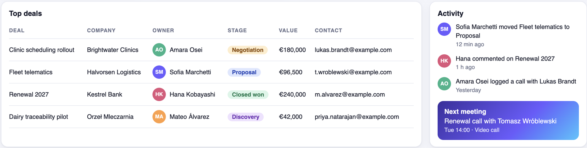
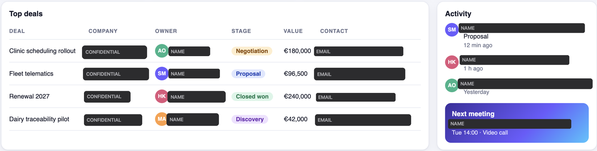
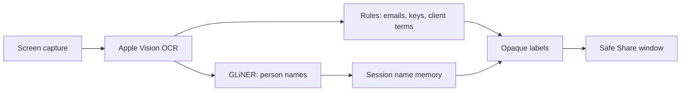

<p align="center">
  
</p>

<h1 align="center">Safe Share</h1>

<p align="center">
  <b>Share your screen with clients without sharing what they shouldn't see.</b><br>
  On-device AI redaction for live screen sharing on macOS.
</p>

<p align="center">
  
  
  
</p>

**Your screen**



**What the client sees in Teams**



## The problem

Software teams share screens with clients every day. One open Teams chat, CRM
view or terminal can show another client's name, a colleague's email or an API key.
That is an NDA or GDPR problem in a single frame, and nobody can watch every pixel
while presenting.

Where it helps:

- **Sprint review:** a PM walks a client through Jira while a chat with another client
  is open next to it.
- **Debugging with a client:** a developer shares an admin panel or a terminal with
  customer emails, tokens and connection strings on screen.
- **Sales demo:** a CRM full of other clients' names, deals and contacts.

## How it works

Safe Share captures your screen, finds sensitive text and covers it before anything is
shown. In Teams you share the **Safe Share** window instead of your screen.



- **On-device.** OCR and the NER model run locally. Screen content never leaves your Mac.
  The network is used once, to download the model, before capture starts.
- **Fail-closed.** A frame is shown only after OCR, detection and masking all succeed.
  On any error, Pause or Stop, the window shows a neutral screen, never a raw frame.
- **Opaque, not blurred.** Sensitive text is fully covered, then labelled `NAME`,
  `EMAIL`, `SECRET` or `CONFIDENTIAL`.
- **Nothing on disk.** No screenshots, no recognized text in logs.

## Why AI

Safe Share runs two AI models on the Mac:

- **Apple Vision text recognition** reads every line of text on screen, with its
  position, so it can be covered exactly.
- **GLiNER** finds the names in that text.

Emails and API keys have a fixed shape, so rules find them. Names don't. A regex cannot
tell "Hana" from "Help".

[GLiNER](https://github.com/urchade/GLiNER) is an open-source named entity recognition
(NER) model: given text and a label such as "person", it marks the words that are
names, judging from context. Safe Share uses its small version, which runs locally on
the Mac. A session memory then keeps a name masked on later frames, even when the model
misses it once.

Results on synthetic test screens (8 scenes, 17 screenshots):

| Detection | Person names masked | Leaks | Harmless lines masked |
|---|---|---|---|
| Rules only | 6% | 112 | 2 / 645 |
| + GLiNER | 92% | 11 | 15 / 645 |
| **+ GLiNER + session memory** | **97%** | **5** | 15 / 645 |

Emails and credentials: 100% in all three. Detection adds about 90 ms per frame.
Full method and results: [docs/EVALUATION.md](docs/EVALUATION.md).

## Quickstart

Tested on macOS 27, Apple silicon. Needs [uv](https://docs.astral.sh/uv/).

```bash
git clone <repo-url>
cd <repo-dir>
uv sync --extra ml
uv run safe-share        # first run downloads the GLiNER model once
```

On first run macOS asks for **Screen Recording** permission for your terminal. Grant it,
then run the command again. If it still asks, quit and reopen the terminal: macOS
applies the permission only to newly started apps.

## Usage

1. Start `uv run safe-share`. Two windows open: **Safe Share** (the redacted screen) and
   **Safe Share Controls**.
2. In Teams, **Share → Window → Safe Share**. Do not share your whole screen.
3. Work as usual. Use **Pause** / **Resume** to blank the output, **Stop** to end the
   session, **Quit** to exit.

Add your clients' names and project code names to `safe_share.toml`:

```bash
cp safe_share.example.toml safe_share.toml
```

```toml
terms = ["Kestrel Bank", "Project Halibut"]   # masked as CONFIDENTIAL
gliner = true                                 # AI name detection
```

`safe_share.toml` is gitignored, so your terms stay on your machine.

## Limitations

- A name the model misses on its first appearance can be visible until it is detected.
- OCR can miss text while scrolling fast or at very small sizes.
- After Resume on a static screen, the output stays neutral until something on screen
  changes.
- macOS only. Tested with Microsoft Teams window sharing.

## What's next

- Test with Zoom and Google Meet window sharing.
- Mask only the name inside a line, not the whole line.
- More entity types: phone numbers, IBANs, addresses.
- A signed macOS app bundle with its own name and icon.

## How it was built

- **Idea and first plan:** brainstormed with GPT-6 Astra.
- **Workspace:** Claude Fable 5.1 set up the Claude Code project: specialized agents,
  settings and implementation rules.
- **Implementation:** Claude Code with Claude Opus 5 and Opus 5.5, in the main session
  and in dedicated agents for ML design, macOS APIs, code review and security review.
  The privacy rules are written down for the agents and checked by the review agents.

## Extending

| Path | What it does |
|---|---|
| `src/safe_share/app.py` | Windows, controls, startup |
| `src/safe_share/capture.py` | Screen capture (ScreenCaptureKit) |
| `src/safe_share/pipeline.py` | Frame scheduling and the privacy guarantees |
| `src/safe_share/ocr.py` | Apple Vision text recognition |
| `src/safe_share/detect.py` | Rule-based detection |
| `src/safe_share/gliner_detect.py` | GLiNER name detection |
| `src/safe_share/name_cache.py` | Session name memory |
| `src/safe_share/redact.py` | Opaque labels |

- **New detector:** implement `detect(texts) -> list[Detection]` from
  [`detect.py`](src/safe_share/detect.py) and combine it with `UnionDetector`.
- **Evaluate:** `uv run python -m safe_share.eval_detect fixtures/detect/names.json --detector union`
  scores name detection on the committed text fixtures.
- **Test:** `uv run pytest`

Security issues: see [SECURITY.md](SECURITY.md).

## License

Licensed under the [Apache License 2.0](LICENSE).
Dependencies and models: [THIRD_PARTY_LICENSES.md](THIRD_PARTY_LICENSES.md).

Copyright (c) 2026 CSHARK Commit Hackathon Contributors

## Team

- Krzysiek Kulig
